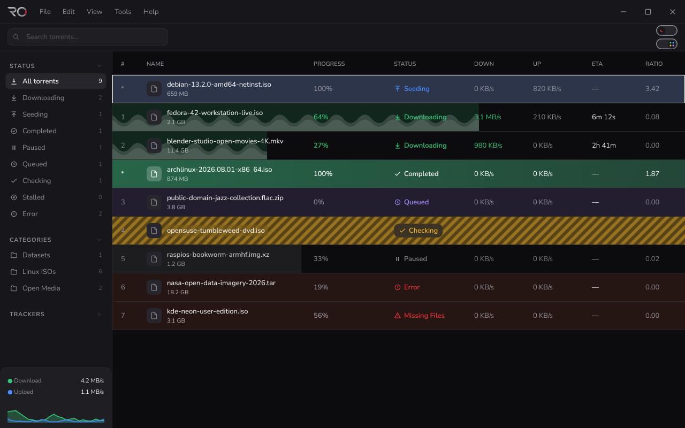
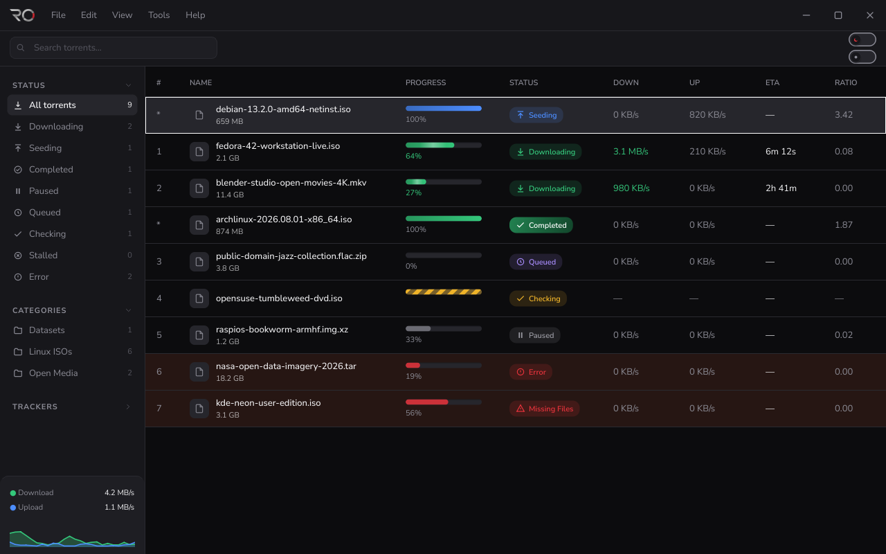
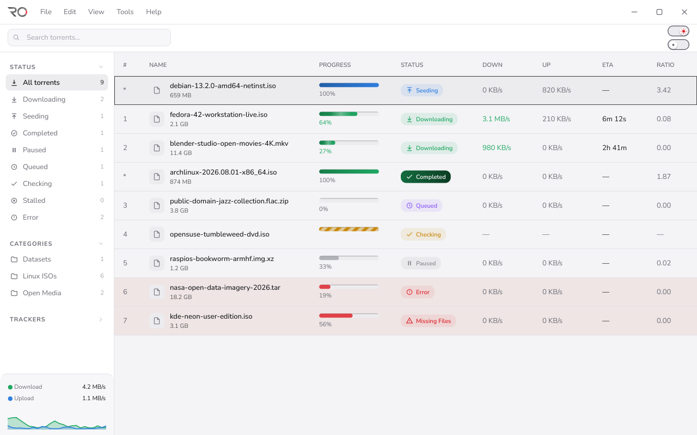

# RoTorrent: a calmer BitTorrent client

**A UX design project, built as working software.** BitTorrent clients are powerful but look like spreadsheets
from 2005. RoTorrent redesigns the everyday experience of managing downloads (what is happening, is anything
wrong, what do I do next?) and implements it as a Windows desktop app in Qt 6 on a real libtorrent engine.

Design and front-end build by **Rohit Malla**. Read the full write-up in [docs/CASE_STUDY.md](docs/CASE_STUDY.md).

| Dark | Light |
|---|---|
|  |  |

## The design in brief

- **Status as a visual language.** 19 engine states collapse into a few that people understand, each with its own
  colour, icon and label. Colour is never the only signal.
- **A sidebar that never lies.** Counts and list filters use one rule, so the number you see is the number of rows you get.
- **Progressive disclosure.** The details panel starts collapsed (38 px), opens into the tab you click, remembers its height.
- **Designed empty and error moments.** Three empty states, error rows tinted instead of alarmed.
- **One dialog shell.** Every dialog shares a title row, hairline, close button and accent-coloured primary action.
- **Cut scope on purpose.** No RSS, search plugins, Web UI, Python integration or tags.
- **Token-based design system.** Dark, Light and a live-switchable Vibrant mode, generated from one token file
  (`tools/build_theme.py`), Nunito Sans, 82 custom icons, custom frameless window chrome.

More screens: [Options](docs/phase7/options_speed_dark.png), [Torrent Creator](docs/phase6/creator_dark.png),
[Cookies](docs/phase6/cookies_dark.png), [Crash info](docs/phase6/crash_info_dark.png), [Quit confirmation](docs/phase6/exit_confirm_dark.png).

## Status

All UI phases are built and the automated suite passes on Linux (offscreen Qt 6.7). **It has not yet been built
with MSVC or run on Windows**, and real pointer interaction is untested. Details in [docs/STATUS.md](docs/STATUS.md).

## Build

Windows 10/11 x64, MSVC 2022, Qt 6.6+, CMake, vcpkg (libtorrent 2.0.10+, Boost, OpenSSL 3, zlib). See [docs/RELEASE.md](docs/RELEASE.md).

    cmake -S . -B build -G Ninja -DCMAKE_BUILD_TYPE=Release -DCMAKE_TOOLCHAIN_FILE=<vcpkg>/scripts/buildsystems/vcpkg.cmake
    cmake --build build

Backend-only check on any host:

    cmake -S . -B build -G Ninja -DROTORRENT_BACKEND_ONLY=ON -DROTORRENT_BUILD_TESTS=ON
    cmake --build build

## Licence and credits

Copyright (C) 2026 Rohit Malla. Released under GPL v2 or later (see `COPYING`).
Based on the qBittorrent project (https://www.qbittorrent.org). RoTorrent is not affiliated with the qBittorrent project.
Built with Qt 6, libtorrent-rasterbar, Boost, OpenSSL and zlib; see [docs/THIRD_PARTY.md](docs/THIRD_PARTY.md).

Website: https://rotorrent.org · Bug reports: the Issues page of https://github.com/kingrobbie928-oss/RoTorrent
