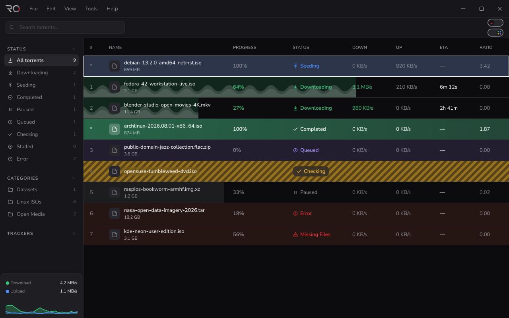
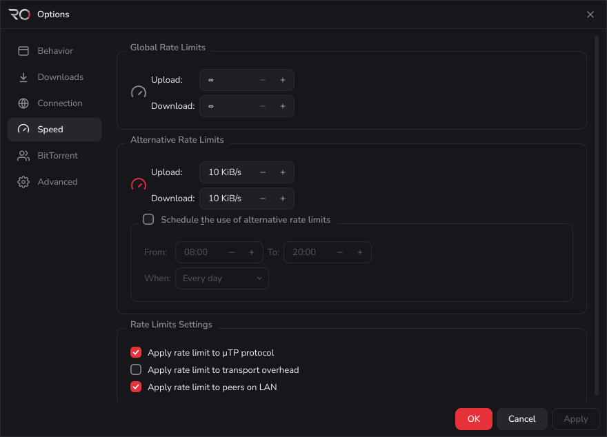
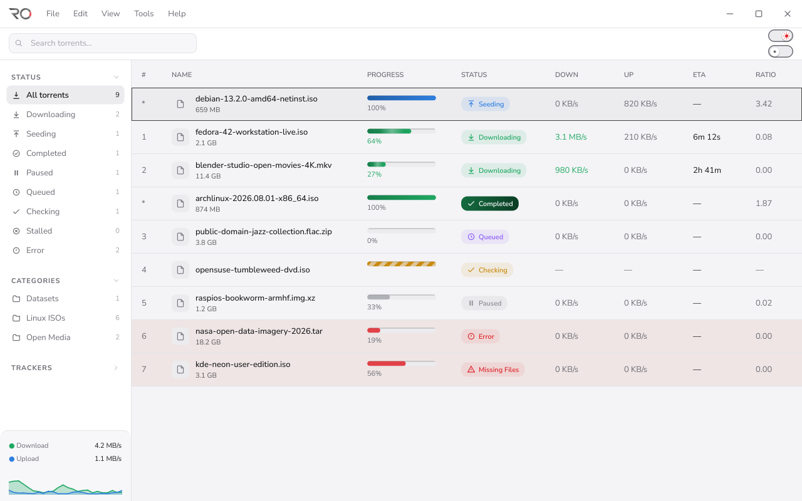

# RoTorrent: a calmer BitTorrent client

*UX case study · Windows desktop app · Design and front-end build · Rohit Malla*

## The one-line story
BitTorrent clients are powerful but look like spreadsheets from 2005. I redesigned the everyday experience of managing
downloads, then built it as a working Windows app on a real torrent engine, so the screens here are implemented
software, not mockups.

## The problem
People open a torrent client for three questions: what is happening, is anything wrong, and what do I do next? Most
clients answer with dense grids, tiny text, identical rows and dialogs that look like a different app. Status is
something you decode, not something you see.

## Goals
1. **Make state readable at a glance.** Know what is downloading, seeding, stuck or broken without reading a word.
2. **Keep power users' speed.** Same features, same shortcuts, less visual noise.
3. **Feel like one product.** Every dialog, menu and empty state follows the same rules.
4. **Work for different tastes and eyes.** Dark, light and an expressive mode, at any screen scale.

## Key design decisions
1. **Status as a visual language.** 19 engine states collapsed into a small set: green for downloading and completed,
   blue seeding, purple queued, amber stripes checking, grey paused and stalled, red errors. Each has its own icon and label.
2. **A sidebar that never lies.** Counts are computed by the same rule that filters the list. Status, Categories and
   Trackers collapse; the speed card with sparkline stays pinned.
3. **Progressive disclosure.** The details panel (General, Trackers, Peers, HTTP Sources, Content, Log) starts at 38 px,
   opens on click, resizes by drag, snaps shut, remembers its height. Only the visible tab refreshes.
4. **Designing the empty and error moments.** Three empty states say what happened and offer a next step. Errors tint
   the row. Quit offers No / Yes / Always Yes; Remove remembers the delete-files choice.
5. **Dialogs that belong to the app.** One shell for every dialog. Options has six groups (Behavior, Downloads,
   Connection, Speed, BitTorrent, Advanced) with a left rail.
   
6. **Cutting scope on purpose.** No RSS, search plugins, Web UI, Python integration or tags.

## The design system
| Layer | Choice |
|---|---|
| Colour | Token-based dark and light palettes; one red accent (#e8323b) for primary actions and focus |
| Semantic colour | Green, blue, purple, amber, grey, each tied to one status |
| Type | Nunito Sans, four weights, 13 px base |
| Icons | 82 custom icons, dark and light variants |
| Themes | Dark, Light, and Vibrant (rows washed with status colour), switchable live |
| Window chrome | Custom frameless title bar (45 px row, 46 x 44 px caption buttons) with snap and resize |

The look is generated from a single token file and QSS kit (`tools/build_theme.py`); rebuilding reproduces every file exactly.

## Craft and accessibility
- **Fidelity.** The implemented title bar is pixel-identical to the design kit at 100%; the table region matches apart from the scrollbar strip.
- **Screen scale.** Checked from 100% to 300%: rows grow instead of clipping.
- **Responsive tables.** Columns follow a 1,070 px reference and wrap or scroll in narrow windows.
- **Motion with purpose.** Animations run only while a visible row needs them.
- **Keyboard and menus.** Full menu structure with shortcuts; context menus enable by selection.
- **Performance as UX.** 500 rows render in about 0.4 s, idle CPU near 0.1% (offscreen, Linux).

## What I did
- Defined the visual language, component rules and interaction patterns
- Designed the full flow set: add, manage, inspect, configure, remove
- Built the design tokens and theme system
- Implemented the interface in Qt 6 on a real libtorrent backend
- Verified states, scaling and edge cases with automated checks and screenshot comparison

## Limits and next steps
- Built and tested on Linux (offscreen); first real Windows build and pointer testing still to do.
- Usability testing with first-time and power users, then iterate on the details panel
- Multi-select and bulk actions
- Accessibility audit: contrast, screen-reader labels, full keyboard paths
- First-run onboarding
